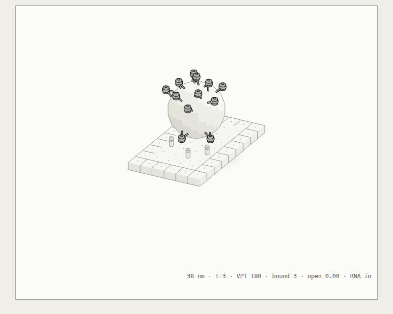
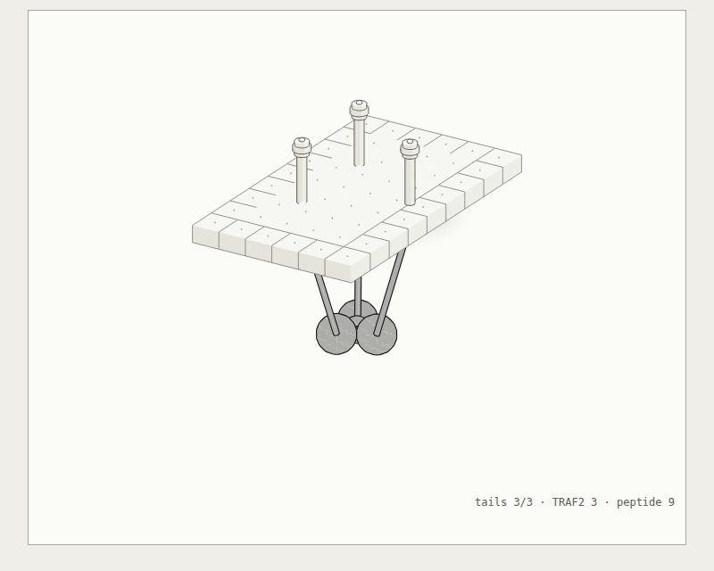

# Virion

An agent skill that explains a pathogen, a virus, or a molecular assembly by drawing the object. Influenza A is the enveloped figure. Norwalk virus is the naked capsid. Any other particle starts from the public structure databases, not from the HHMI list.

The working rule is the same one as [Anatomy](https://github.com/wheresryan22/anatomy): the object is the explanation. Spikes, pores, and RNA rods move. The numbers on the card come from the model that moves them. This kit is not a copy of Anatomy's. It is a smaller one for membranes and spikes, held to that standard.

## The figure

Open [`examples/influenza/influenza.html`](examples/influenza/influenza.html). Drag to turn the particle. Keys 1–5 rest on bind, enter, fuse, uncoat, and bud. Space plays the cycle. E takes it apart. `[` and `]` change the pace.

<p>
  
</p>

<p>
  
</p>

The influenza cycle follows the [HHMI Virus Explorer influenza page](https://media.hhmi.org/biointeractive/click/virus-explorer/influenza.html). Spike counts and tip lengths are from Harris et al., PNAS 2006. The caption on the figure names every source. What the sources do not measure is marked as schematic in [`references/influenza.md`](references/influenza.md).

## A second architecture

Open [`examples/norovirus/norovirus.html`](examples/norovirus/norovirus.html). Keys 1–4 rest on dock, enter, uncoat, and lyse. This particle is not on the HHMI list. The cycle is the [ViralZone norovirus page](https://viralzone.expasy.org/194). The 38 nm T=3 capsid, 90 dimers, and the shell radii are from Prasad et al. 1994 and [PDB 1IHM](https://www.rcsb.org/structure/1IHM).

<p>
  
</p>

Where to look up any other pathogen or molecule — PDB, EMDB, VIPERdb, NIH 3D, Viro3D, AlphaFold, PHIL — is [`references/databases.md`](references/databases.md). HHMI covers only the viruses they drew.

## A name that is not a particle

Hodgkin lymphoma is a cancer, not a virion. The skill does not invent a cell or a virus for it. The object it can draw is CD30's cytoplasmic tail on TRAF2, [PDB 1D01](https://www.rcsb.org/structure/1D01). Open [`examples/hodgkin/hodgkin.html`](examples/hodgkin/hodgkin.html). Key 1 is the free receptor. Key 2 docks the three tails.

<p>
  
</p>

## Install

The skill is the `virion/` folder, with `SKILL.md` at its root.

```sh
git clone https://github.com/massimodeluisa/massimodeluisa.git
```

Copy or symlink `virion` into the skills directory your agent reads, so `SKILL.md` lands at `<skills>/virion/SKILL.md`.

Rebuild the page with Node 20 or later. There is nothing to install.

```sh
node examples/influenza/check.mjs
node examples/influenza/build.mjs
node examples/influenza/build.mjs --dark
node examples/norovirus/check.mjs
node examples/norovirus/build.mjs
node examples/hodgkin/check.mjs
node examples/hodgkin/build.mjs
```

`examples/influenza/Influenza.jsx` is the same scene as a React client component. It imports the model. It does not carry a second set of numbers.

## Layout

```text
virion/
├── SKILL.md
├── kit/                 camera, solids, biological parts, the card
├── references/          databases, the two worked particles, sources, craft, kit API
├── examples/influenza/  enveloped particle
├── examples/norovirus/  naked T=3 capsid from ViralZone and PDB 1IHM
├── examples/hodgkin/    CD30 tail on TRAF2, PDB 1D01. Not a drawing of the cell
└── evals/evals.json
```

## Boundary

The skill draws the published cycle. It does not produce sequences, reverse genetics, culture, or ways to change a virus. That line is in [`references/sources.md`](references/sources.md) and in `SKILL.md`.
