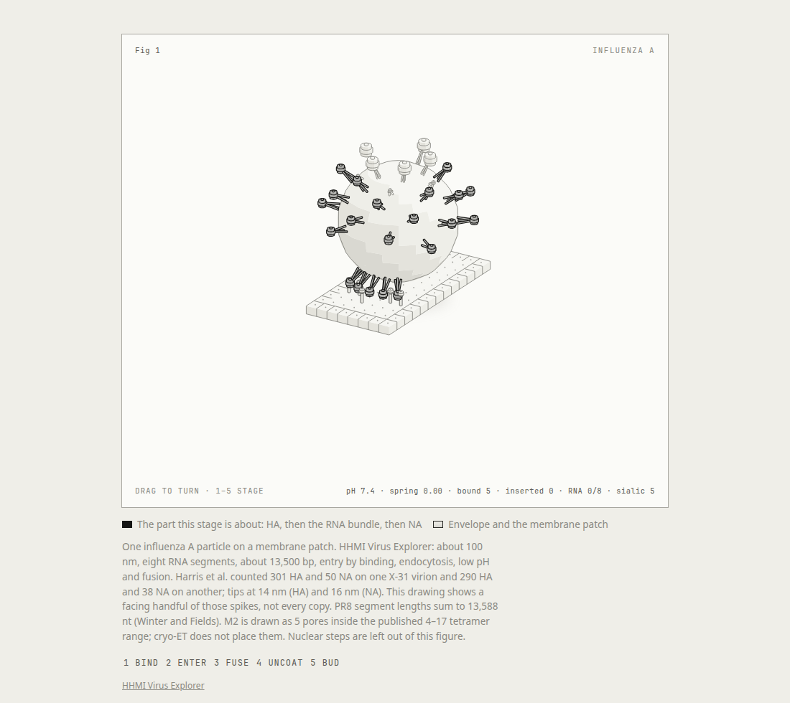
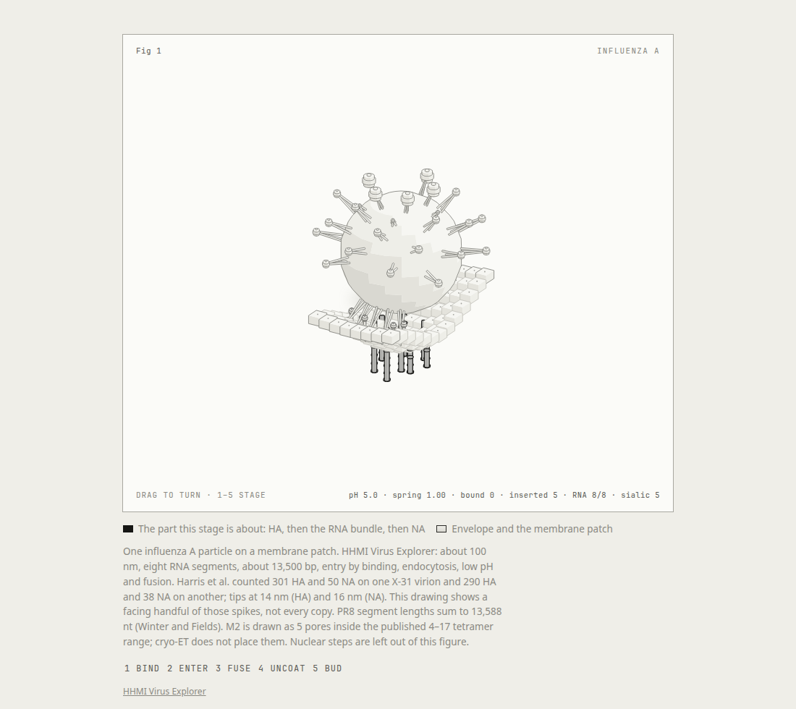

# Virion

An agent skill that explains a virus by drawing the particle. The first figure is influenza A: one virion on a patch of membrane, from binding to budding.

The working rule is the same one as [Anatomy](https://github.com/wheresryan22/anatomy): the object is the explanation. Spikes, pores, and RNA rods move. The numbers on the card come from the model that moves them. This kit is not a copy of Anatomy's. It is a smaller one for membranes and spikes, held to that standard.

## The figure

Open [`examples/influenza/influenza.html`](examples/influenza/influenza.html). Drag to turn the particle. Keys 1–5 rest on bind, enter, fuse, uncoat, and bud. Space plays the cycle. E takes it apart. `[` and `]` change the pace.

<p>
  
</p>

<p>
  
</p>

The cycle follows the [HHMI Virus Explorer influenza page](https://media.hhmi.org/biointeractive/click/virus-explorer/influenza.html). Spike counts and tip lengths are from Harris et al., PNAS 2006. The caption on the figure names every source. What the sources do not measure is marked as schematic in [`references/influenza.md`](references/influenza.md).

## Install

The skill is the `virion/` folder, with `SKILL.md` at its root.

```sh
git clone https://github.com/massimodeluisa/massimodeluisa.git
```

Copy or symlink `virion` into the skills directory your agent reads, so `SKILL.md` lands at `<skills>/virion/SKILL.md`.

Rebuild the page with Node 20 or later. There is nothing to install.

```sh
node examples/influenza/check.mjs
node examples/influenza/build.mjs
node examples/influenza/build.mjs --dark
```

`examples/influenza/Influenza.jsx` is the same scene as a React client component. It imports the model. It does not carry a second set of numbers.

## Layout

```text
virion/
├── SKILL.md
├── kit/                 camera, solids, biological parts, the card
├── references/          influenza facts, sources, craft, kit API
├── examples/influenza/  facts, model, scene, the built pages
└── evals/evals.json
```

## Boundary

The skill draws the published cycle. It does not produce sequences, reverse genetics, culture, or ways to change a virus. That line is in [`references/sources.md`](references/sources.md) and in `SKILL.md`.
